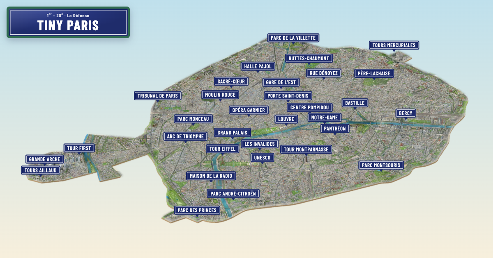

# Tiny Paris

**[tiny.paris](https://tiny.paris)**: Paris as a living isometric toy city.

[](https://tiny.paris)

All of Paris inside the périphérique, plus Neuilly and La Défense, as one
hand-painted-looking isometric map. The city is first drawn in code from
OpenStreetMap and IGN data (109,000 buildings with their real heights, ages
and roofs), then repainted tile by tile with an image model. On top of the
painting, thousands of cars, RATP buses on their real lines, métro trains,
Vélib' bikes, boats and people go about their day, and every building can be
clicked for what the data knows about it.

No framework and no map library: TypeScript, a 2D canvas and Vite.

```sh
npm install
npm run dev        # http://localhost:5173
npm run build
```

Everything the site needs (map data, painted tiles, sprites) is in `public/`,
so it runs as cloned, with no key and no account.

Drag to pan, scroll or pinch to zoom, +/− to zoom, H for the whole map, N to
hide place names, L for night, W to wander, click a building for details.
The map is at night when it's dark in Paris, until you say otherwise.

## How it works

| | |
|---|---|
| `src/model.ts` | loads the packed city (`public/data/paris.bin`) into buildings, streets, métro lines |
| `src/render.ts` | the isometric renderer: the plain 3D map the painting is made from, and what hides vehicles behind buildings |
| `src/painted.ts` | the painted map, as tiles at five levels of detail |
| `src/traffic.ts`, `life.ts`, `streetlife.ts` | everything that moves: one-way streets, queues, traffic lights, bus stops and métro stations |
| `src/labels.ts`, `sun.ts` | street and arrondissement names; when the sun sets over Paris |
| `src/main.ts` | camera, input, search, the building card |
| `api/report.ts` | the "something's wrong here" form, saved to Vercel Blob (optional: the map works without it) |

In `npm run dev`, press A to switch between the painting and the plain 3D map
underneath it.

## Rebuilding the map

You only need this to change the map itself. Each script says more at its top.

**1. The city's data**, from OpenStreetMap and IGN. Needs
[osmium](https://osmcode.org/osmium-tool/) (`brew install osmium-tool`).

```sh
node scripts/fetch-boundary.mjs   # the outline: Paris inside the périphérique
node scripts/extend-boundary.mjs  # …plus Neuilly and La Défense
node scripts/fetch-bdtopo.mjs     # IGN building heights, materials and years
npm run data                      # OSM buildings, streets, water, trees → paris.json, packed into paris.bin
npm run data:streets              # one-way streets, street names, traffic lights, bus and métro stops
npm run data:transit              # bus lines, Vélib' stations, waterways
npm run data:pois                 # cafés, for the terraces
```

The painting is aligned to this data building for building: after `npm run data`
with fresh OSM data, the tiles that changed need repainting. `data:streets`
reads the same extract (kept in `paint/osm/`) and writes a file of its own, so
it can be run again without touching the rest.

**2. The painting.** Needs a [Gemini API key](https://aistudio.google.com/apikey);
this step costs money. `2-paint.mjs` stops at `--budget` euros (9 by default)
across all runs, skips tiles already painted, and so can be resumed.

```sh
node scripts/paint/0-ortho.mjs    # IGN aerial photos and LiDAR heights, to texture and shape the base render
node scripts/paint/0-eaves.mjs
npm run paint:base                # renders the plain 3D map as overlapping tiles → paint/base/
GEMINI_API_KEY=… npm run paint    # repaints each tile → paint/painted/
node scripts/paint/check.mjs      # flags tiles the model got wrong
npm run paint:stitch              # blends them into public/painted/
node scripts/thumbs.mjs           # the landmark pictures of the desktop strip
```

`scripts/paint/spot.mjs` repaints a single spot, for fixing one building.
The working files go in `paint/` (several GB, not in the repo).

**3. The sprites** (vehicles, boats, people), baked from 3D models:
`node scripts/sprites/bake.mjs`.

## Tests

```sh
npm run typecheck  # the app and api/
npm test           # unit tests (Vitest): data files, traffic rules, landmarks, métro shapes, report API
npm run build && npm run test:e2e   # smoke tests in Chrome (Playwright), desktop and phone
```

GitHub Actions runs all of them on every push and pull request
(`.github/workflows/ci.yml`).

`npm run perf` measures what a slow phone would feel (Chrome with its CPU
slowed four times): the longest freezes while the city loads, and frames per
second with the traffic running, by day and by night. Run it before and after
a change to the drawing or the traffic.

## License

The code is under the [MIT License](LICENSE).

Map data © [OpenStreetMap](https://www.openstreetmap.org/copyright) contributors,
ODbL. Building data, aerial photos, LiDAR and the address search © IGN
([BD TOPO](https://geoservices.ign.fr/bdtopo), Géoplateforme), Licence Ouverte
Etalab 2.0. 3D models by [Kenney](https://kenney.nl), CC0. Building photos
from Wikipedia. Fonts: Barlow, Barlow Condensed and IBM Plex Mono, SIL Open
Font License.

Inspired by the maps collected on [isocities](https://isocities.agenturl.dev/).
